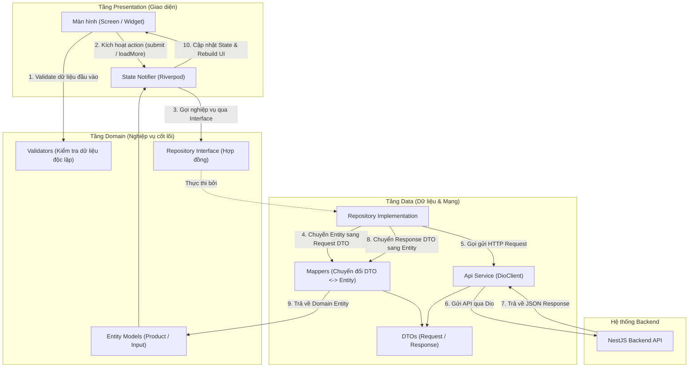
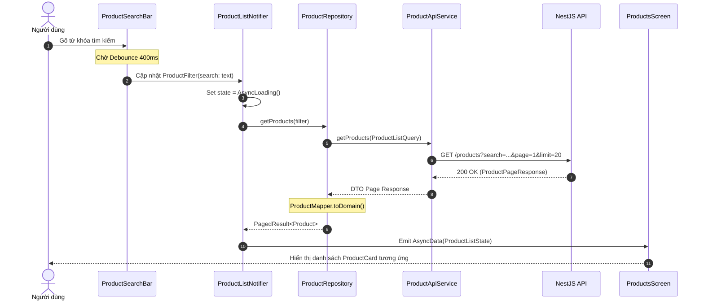
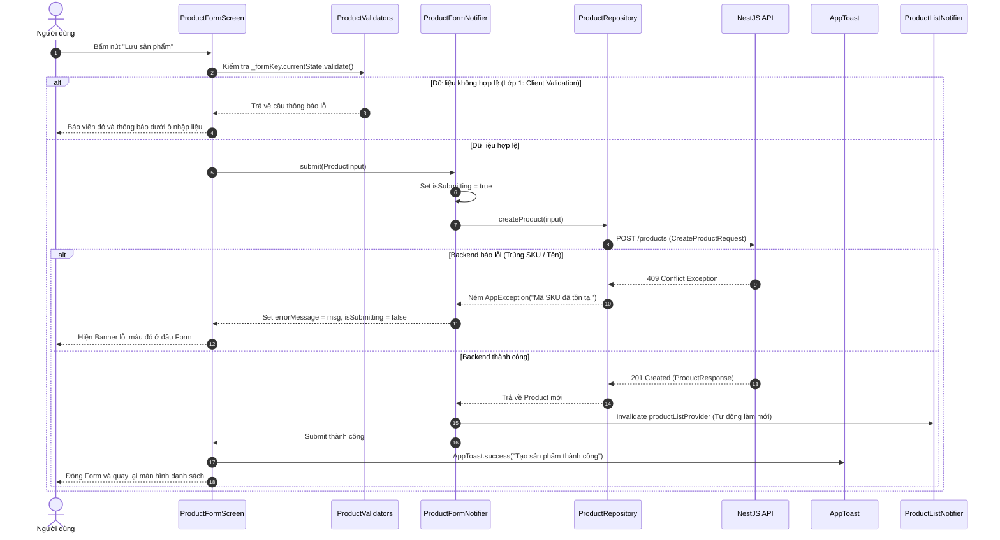

# 📘 Hướng Dẫn Chi Tiết Xây Dựng Feature Hoàn Chỉnh (Chuẩn FINORA Mobile)

> **Mục tiêu**: Tài liệu này đóng vai trò là kim chỉ nam (Golden Standard) hướng dẫn lập trình viên xây dựng một feature mới từ A-Z theo mô hình **Clean Architecture** kết hợp **Riverpod 2.x Notifier**, dựa trên kiến trúc thực tế của feature chuẩn mẫu `lib/features/products`.

---

## 📑 Mục lục
1. [Triết lý kiến trúc & Luồng dữ liệu (Data Flow)](#1-triết-lý-kiến-trúc--luồng-dữ-liệu)
   - [1.1. Sơ đồ kiến trúc luồng dữ liệu](#11-sơ-đồ-kiến-trúc-luồng-dữ-liệu-data-flow-diagram)
   - [1.2. Sơ đồ chi tiết 2 luồng tương tác thực tế (Read & Write Flow)](#12-sơ-đồ-chi-tiết-2-luồng-tương-tác-thực-tế)
   - [1.3. Nguyên tắc bất biến (Dependency Rule)](#13-nguyên-tắc-bất-biến-dependency-rule)
2. [Cấu trúc thư mục chuẩn](#2-cấu-trúc-thư-mục-chuẩn)
3. [Quy trình 3 bước triển khai](#3-quy-trình-3-bước-triển-khai)
   - [Bước 1: Tầng Domain (Core Business)](#bước-1-tầng-domain)
   - [Bước 2: Tầng Data (API & DTO)](#bước-2-tầng-data)
   - [Bước 3: Tầng Presentation (State Management & UI)](#bước-3-tầng-presentation)
4. [Tối ưu UX & Xử lý lỗi theo chuẩn FinTech](#4-tối-ưu-ux--xử-lý-lỗi)
5. [Quy chuẩn Kiểm thử (Unit Testing)](#5-quy-chuẩn-kiểm-thử)
6. [Checklist nghiệm thu Feature](#6-checklist-nghiệm-thu-feature)
7. [Quy trình làm việc với Git (Git Workflow)](#7-quy-trình-làm-việc-với-git-git-workflow)

---

## 1. Triết lý kiến trúc & Luồng dữ liệu

Dự án FINORA Mobile tuân thủ nghiêm ngặt **Clean Architecture** với 3 tầng chính:

```
┌────────────────────────────────────────────────────────┐
│                   PRESENTATION                         │
│   (Screens, Widgets, Providers/Notifiers, States)       │
└───────────────────────────┬────────────────────────────┘
                            │ depends on
┌───────────────────────────▼────────────────────────────┐
│                      DOMAIN                            │
│   (Entities/Models, Repository Interfaces, Validators)  │
└───────────────────────────▲────────────────────────────┘
                            │ implements
┌───────────────────────────┴────────────────────────────┐
│                       DATA                             │
│     (DTOs, Mappers, Api Services, Repository Impl)     │
└────────────────────────────────────────────────────────┘
```

### 1.1. Sơ đồ kiến trúc luồng dữ liệu (Data Flow Diagram)

Sơ đồ dưới đây minh họa sự phối hợp giữa các thành phần khi xử lý yêu cầu:



---

### 1.2. Sơ đồ chi tiết 2 luồng tương tác thực tế

#### A. Luồng Hiển thị & Tìm kiếm danh sách (Read Flow)
Minh họa quá trình người dùng tìm kiếm sản phẩm với cơ chế chống spam (Debounce 400ms):



#### B. Luồng Tạo mới / Chỉnh sửa & Validate (Write Flow)
Minh họa quá trình người dùng nhập form, validate 2 lớp và cập nhật state:



---

### 1.3. Nguyên tắc bất biến (Dependency Rule):
* **Domain là độc lập tuyệt đối**: Không import code từ tầng `Data` hay `Presentation`. Không phụ thuộc vào bất kỳ thư viện UI hay HTTP nào.
* **Data phụ thuộc Domain**: Implement các Repository Interface từ Domain, chuyển đổi qua lại giữa DTO (mạng) và Domain Model (nghiệp vụ).
* **Presentation phụ thuộc Domain**: Chỉ giao tiếp với Domain Entities và Repository Interface qua Riverpod Providers.

---

## 2. Cấu trúc thư mục chuẩn

Khi tạo một feature mới (ví dụ: `customers`, `debts`, `transactions`), hãy tổ chức cấu trúc thư mục giống hệt `features/products`:

```
lib/features/<feature_name>/
├── domain/
│   ├── models/                    # Thực thể nghiệp vụ (Entities)
│   │   ├── <model>.dart           # Entity chính (Product)
│   │   ├── <model>_input.dart     # Dữ liệu đầu vào khi Create/Update
│   │   ├── <model>_filter.dart    # Tiêu chí lọc/sắp xếp
│   │   └── <model>_category.dart  # Enums liên quan
│   ├── repositories/
│   │   └── <model>_repository.dart# Interface (Hợp đồng dữ liệu)
│   └── validators/
│       └── <model>_validators.dart# Pure functions kiểm tra dữ liệu
│
├── data/
│   ├── dto/                       # Data Transfer Objects khớp API Backend
│   │   ├── <model>_response.dart
│   │   ├── <model>_page_response.dart
│   │   ├── create_<model>_request.dart
│   │   └── update_<model>_request.dart
│   ├── mappers/                   # Chuyển đổi DTO <-> Domain Model
│   │   └── <model>_mapper.dart
│   ├── services/                  # Gọi HTTP qua DioClient
│   │   ├── <model>_api_service.dart
│   │   └── mock_<model>_api_service.dart (tuỳ chọn)
│   └── repositories/              # Thực thi Repository Interface
│       └── <model>_repository_impl.dart
│
├── presentation/
│   ├── providers/                 # State Management với Riverpod Notifier
│   │   ├── <model>_providers.dart # DI cho Service, Repository
│   │   ├── <model>_list_provider.dart
│   │   ├── <model>_list_state.dart
│   │   ├── <model>_detail_provider.dart
│   │   ├── <model>_form_provider.dart
│   │   ├── <model>_form_state.dart
│   │   └── <model>_filter_provider.dart
│   ├── screens/                   # Các màn hình chính
│   │   ├── <model>s_screen.dart       # Danh sách
│   │   ├── <model>_detail_screen.dart # Chi tiết
│   │   └── <model>_form_screen.dart   # Thêm mới / Chỉnh sửa
│   └── widgets/                   # Các thành phần giao diện nhỏ
│       ├── <model>_card.dart
│       ├── <model>_search_bar.dart
│       ├── <model>_filter_sheet.dart
│       └── <model>_filter_chips.dart
│
└── <feature_name>.dart            # Barrel file export các file cần thiết
```

---

## 3. Quy trình 3 bước triển khai

### BƯỚC 1: Tầng Domain (Core Business)

Luôn bắt đầu từ Domain vì đây là nơi định nghĩa "Feature này làm gì và chứa dữ liệu gì".

#### 1.1. Entity chính (`domain/models/product.dart`)
Chỉ chứa các trường dữ liệu thuần Dart, `id`, ngày tạo, các thuộc tính nghiệp vụ.
```dart
class Product {
  const Product({
    required this.id,
    required this.name,
    required this.sku,
    required this.price,
    required this.stock,
    required this.category,
    this.description,
    this.imageUrl,
    this.isAvailable = true,
    this.createdAt,
    this.updatedAt,
  });

  final String id;
  final String name;
  final String sku;
  final double price;
  final int stock;
  final ProductCategory category;
  final String? description;
  final String? imageUrl;
  final bool isAvailable;
  final DateTime? createdAt;
  final DateTime? updatedAt;
}
```

#### 1.2. Dữ liệu đầu vào Form (`domain/models/product_input.dart`)
Dùng khi người dùng nhập trên màn hình Tạo / Sửa:
```dart
class ProductInput {
  const ProductInput({
    required this.name,
    required this.sku,
    required this.price,
    required this.stock,
    required this.category,
    this.description,
    this.imageUrl,
    this.isAvailable = true,
  });

  final String name;
  final String sku;
  final double price;
  final int stock;
  final ProductCategory category;
  final String? description;
  final String? imageUrl;
  final bool isAvailable;
}
```

#### 1.3. Repository Interface (`domain/repositories/product_repository.dart`)
Định nghĩa hợp đồng dữ liệu không phụ thuộc vào nguồn (API hay Local DB):
```dart
abstract class ProductRepository {
  Future<PagedResult<Product>> getProducts(ProductFilter filter);
  Future<Product> getProductById(String id);
  Future<Product> createProduct(ProductInput input);
  Future<Product> updateProduct(String id, ProductInput input);
  Future<void> deleteProduct(String id);
}
```

#### 1.4. Validator độc lập (`domain/validators/product_validators.dart`)
Tách hoàn toàn validation ra khỏi UI dưới dạng **pure static functions**:
```dart
class ProductValidators {
  ProductValidators._();

  static final _skuRegex = RegExp(r'^[A-Z0-9\-_]+$');

  static String? validateName(String? value) {
    final t = value?.trim() ?? '';
    if (t.isEmpty) return 'Vui lòng nhập tên sản phẩm';
    if (t.length < 2) return 'Tên quá ngắn (tối thiểu 2 ký tự)';
    if (t.length > 200) return 'Tên tối đa 200 ký tự';
    return null;
  }

  static String? validateSku(String? value) {
    final t = value?.trim() ?? '';
    if (t.isEmpty) return 'Vui lòng nhập mã SKU';
    if (t.length < 2) return 'Mã SKU tối thiểu 2 ký tự';
    if (!_skuRegex.hasMatch(t.toUpperCase())) {
      return 'Mã SKU chỉ gồm chữ cái, số, gạch ngang (-) hoặc gạch dưới (_)';
    }
    return null;
  }
}
```

---

### BƯỚC 2: Tầng Data (API & DTO)

#### 2.1. DTOs (`data/dto/`)
Map 1-1 với JSON của Backend NestJS:
```dart
class ProductResponse {
  final String id;
  final String name;
  final String sku;
  final num price;
  final int stock;
  final String category;
  final String? description;
  final String? imageUrl;
  final bool isAvailable;

  factory ProductResponse.fromJson(Map<String, dynamic> json) => ...;
}
```

#### 2.2. Mapper (`data/mappers/product_mapper.dart`)
Chuyển đổi giữa DTO và Entity Domain:
```dart
class ProductMapper {
  static Product toDomain(ProductResponse dto) {
    return Product(
      id: dto.id,
      name: dto.name,
      sku: dto.sku,
      price: dto.price.toDouble(),
      stock: dto.stock,
      category: ProductCategory.fromValue(dto.category),
      description: dto.description,
      imageUrl: dto.imageUrl,
      isAvailable: dto.isAvailable,
    );
  }

  static CreateProductRequest toCreateRequest(ProductInput input) {
    return CreateProductRequest(
      name: input.name,
      sku: input.sku,
      price: input.price,
      stock: input.stock,
      category: input.category.name,
      description: input.description,
      imageUrl: input.imageUrl,
      isAvailable: input.isAvailable,
    );
  }
}
```

#### 2.3. API Service (`data/services/product_api_service.dart`)
Sử dụng singleton `DioClient` của hệ thống:
```dart
class ProductApiService {
  ProductApiService(this._dio);
  final DioClient _dio;

  Future<ProductPageResponse> getProducts(ProductListQuery query) async {
    final res = await _dio.get('/products', queryParameters: query.toJson());
    return ProductPageResponse.fromJson(res.data['data']);
  }

  Future<ProductResponse> createProduct(CreateProductRequest req) async {
    final res = await _dio.post('/products', data: req.toJson());
    return ProductResponse.fromJson(res.data['data']);
  }
}
```

#### 2.4. Repository Implementation (`data/repositories/product_repository_impl.dart`)
Gọi API Service và dùng Mapper chuyển sang Domain Entity:
```dart
class ProductRepositoryImpl implements ProductRepository {
  ProductRepositoryImpl(this._api);
  final ProductApiService _api;

  @override
  Future<Product> createProduct(ProductInput input) async {
    final req = ProductMapper.toCreateRequest(input);
    final res = await _api.createProduct(req);
    return ProductMapper.toDomain(res);
  }
}
```

---

### BƯỚC 3: Tầng Presentation (State Management & UI)

#### 3.1. Dependency Injection (`presentation/providers/product_providers.dart`)
Khai báo providers cho API và Repository:
```dart
final productApiServiceProvider = Provider<ProductApiService>((ref) {
  final dio = ref.watch(dioClientProvider);
  return ProductApiService(dio);
});

final productRepositoryProvider = Provider<ProductRepository>((ref) {
  final api = ref.watch(productApiServiceProvider);
  return ProductRepositoryImpl(api);
});
```

#### 3.2. List State Notifier (`presentation/providers/product_list_provider.dart`)
Quản lý:
* Tải trang đầu + Phân trang vô hạn (`loadMore`)
* Pull-to-refresh
* Lọc & Sắp xếp tự động invalidate
* Xóa sản phẩm khỏi list ngay lập tức sau khi gọi API thành công

```dart
class ProductListNotifier extends AsyncNotifier<ProductListState> {
  @override
  Future<ProductListState> build() async {
    final filter = ref.watch(productFilterProvider);
    return _fetchPage(page: 1, filter: filter);
  }

  Future<void> loadMore() async {
    final current = state.value;
    if (current == null || !current.hasMore || current.isLoadingMore) return;
    // Tải trang tiếp theo và gộp dữ liệu
  }

  Future<void> deleteProduct(String id) async {
    await ref.read(productRepositoryProvider).deleteProduct(id);
    // Cập nhật state cục bộ loại bỏ item
    final cur = state.value;
    if (cur != null) {
      state = AsyncData(cur.copyWith(
        items: cur.items.where((p) => p.id != id).toList(),
        total: cur.total - 1,
      ));
    }
  }
}
```

#### 3.3. Form State Notifier (`presentation/providers/product_form_provider.dart`)
Dùng `AutoDisposeFamilyNotifier<ProductFormState, String?>`:
```dart
class ProductFormNotifier extends AutoDisposeFamilyNotifier<ProductFormState, String?> {
  @override
  ProductFormState build(String? id) => const ProductFormState();

  Future<Product?> submit(ProductInput input) async {
    if (state.isSubmitting) return null;
    state = state.copyWith(isSubmitting: true, clearError: true);

    try {
      final repo = ref.read(productRepositoryProvider);
      final saved = arg == null
          ? await repo.createProduct(input)
          : await repo.updateProduct(arg!, input);

      // Invalidate các provider liên quan
      ref.invalidate(productListProvider);
      if (arg != null) ref.invalidate(productDetailProvider(arg!));

      state = state.copyWith(isSubmitting: false);
      return saved;
    } catch (e) {
      final msg = e is AppException ? e.message : e.toString();
      state = state.copyWith(isSubmitting: false, errorMessage: msg);
      return null;
    }
  }
}
```

#### 3.4. Form UI (`presentation/screens/product_form_screen.dart`)
Tích hợp:
* `FormKey` kiểm tra trước khi gửi
* Sử dụng `ProductValidators`
* Bổ sung `inputFormatters` chặn ký tự sai
* Hiển thị banner đỏ nếu Backend ném lỗi (như SKU đã tồn tại)

```dart
TextFormField(
  controller: _name,
  decoration: const InputDecoration(
    labelText: 'Tên sản phẩm *',
    border: OutlineInputBorder(),
  ),
  validator: ProductValidators.validateName,
),
const SizedBox(height: 16),
TextFormField(
  controller: _sku,
  inputFormatters: [
    FilteringTextInputFormatter.allow(RegExp(r'[a-zA-Z0-9\-_]')),
  ],
  validator: ProductValidators.validateSku,
),
```

---

## 4. Tối ưu UX & Xử lý lỗi theo chuẩn FinTech

1. **Thông báo Toast**:
   - Sử dụng `AppToast.success(context, '...')` hoặc `AppToast.error(context, '...')` từ `core/widgets/app_toast.dart`.
   - **Tuyệt đối không dùng** `ScaffoldMessenger.showSnackBar` ad-hoc.
2. **Xác nhận trước khi xóa**:
   - Sử dụng hộp thoại dùng chung `showConfirmDialog` từ `core/widgets/confirm_dialog.dart`.
3. **Tìm kiếm mượt mà**:
   - Luôn tích hợp **Debounce 400ms** trong ô tìm kiếm (`ProductSearchBar`) để tránh gửi request liên tục lên backend.
4. **Hệ thống màu & Typography**:
   - Màu sắc: Dùng token chuẩn từ `AppColors` (ví dụ `AppColors.primary`, `AppColors.danger`, `AppColors.darkBackground`).
   - Kiểu chữ: Dùng `AppTextStyles` thay vì tự gõ `fontSize/fontWeight`.

---

## 5. Quy chuẩn Kiểm thử (Unit Testing)

Tất cả các validator và mapper của feature đều phải được viết Unit Test tương ứng trong thư mục `test/features/<feature>/`:

```dart
// test/features/products/product_validators_test.dart
void main() {
  group('ProductValidators - validateName', () {
    test('trả về lỗi khi để trống', () {
      expect(ProductValidators.validateName(''), 'Vui lòng nhập tên sản phẩm');
    });

    test('hợp lệ khi tên từ 2 đến 200 ký tự', () {
      expect(ProductValidators.validateName('Bàn phím cơ Finora'), isNull);
    });
  });
}
```

Chạy kiểm thử:
```bash
flutter test test/features/<feature_name>/
```

---

## 6. Checklist nghiệm thu Feature

Trước khi bàn giao một feature, kiểm tra qua danh sách:

- [ ] **Kiến trúc**: Đầy đủ 3 tầng `domain`, `data`, `presentation` độc lập.
- [ ] **Validation**: Tách class `*Validators` riêng, test biên min/max/rỗng đầy đủ.
- [ ] **Input UX**: Có `inputFormatters` cho ô số/SKU/mã định danh.
- [ ] **Lọc & Tìm kiếm**: Ô tìm kiếm có debounce chống spam API.
- [ ] **Xóa**: Dùng `showConfirmDialog` và cập nhật state danh sách ngay khi xóa thành công.
- [ ] **Thông báo**: Toàn bộ phản hồi dùng `AppToast`.
- [ ] **Static Analysis**: Chạy `flutter analyze lib/` đạt **0 issues (0 errors, 0 warnings)**.

---

## 7. Quy trình làm việc với Git (Git Workflow)

Nhằm đảm bảo tính toàn vẹn của mã nguồn và sự an toàn khi làm việc nhóm, mọi thành viên khi phát triển feature mới **bắt buộc tuân thủ nghiêm ngặt quy trình sau**:

### 7.1. Quy ước đặt tên nhánh (Branch Naming)
Mỗi thành viên khi được giao một feature sẽ tạo một nhánh riêng từ nhánh chính (`main` hoặc `develop`) theo định dạng:
```
feature/<ten_feature>
```
* **Ví dụ thực tế**:
  - `feature/budgets` (Quản lý ngân sách)
  - `feature/transactions` (Quản lý thu chi / giao dịch)
  - `feature/debts` (Quản lý sổ nợ)
  - `feature/customers` (Quản lý đối tác / khách hàng)
  - `feature/reports` (Báo cáo & thống kê)

### 7.2. Các bước thực hiện chi tiết

#### 🔹 Bước 1: Kéo code mới nhất và tạo nhánh tính năng
```bash
# Chuyển về nhánh chính và cập nhật bản mới nhất
git checkout develop
git pull origin develop

# Tạo nhánh mới và chuyển sang nhánh đó
git checkout -b feature/<ten_feature>
# Ví dụ: git checkout -b feature/budgets
```

#### 🔹 Bước 2: Phát triển và Commit theo chuẩn (Semantic Commits)
Nên commit thường xuyên theo từng giai đoạn hoàn thiện thay vì dồn một commit khổng lồ:
```bash
git add .
git commit -m "feat(budgets): add domain models, repository interface and validators"

git add .
git commit -m "feat(budgets): implement api service, dtos and mapper"

git add .
git commit -m "feat(budgets): create budget list, detail and form screens"
```

#### 🔹 Bước 3: Kiểm tra chất lượng trước khi Push
Trước khi đẩy mã nguồn lên máy chủ, chạy lệnh kiểm tra tĩnh:
```bash
flutter analyze lib/
flutter test test/features/<ten_feature>/
```
> Chỉ đẩy code khi `flutter analyze` báo **0 issues found**.

#### 🔹 Bước 4: Đẩy nhánh lên Remote Repository
```bash
git push -u origin feature/<ten_feature>
# Ví dụ: git push -u origin feature/budgets
```

#### 🔹 Bước 5: Tạo Pull Request (PR)
1. Truy cập giao diện GitHub / GitLab của dự án.
2. Tạo một **Pull Request (PR)** mới:
   - **Base branch** (nhánh đích): `develop`
   - **Compare branch** (nhánh nguồn): `feature/<ten_feature>`
3. Điền tiêu đề và nội dung PR rõ ràng:
   - Danh sách màn hình & chức năng đã hoàn thành.
   - Ảnh chụp màn hình / video demo (nếu có).
   - Đính kèm kết quả pass `flutter analyze` và `flutter test`.
4. Gán **Reviewers** (Tech Lead hoặc người được chỉ định review).

---

> [!CAUTION]
> ### ⛔ NGUYÊN TẮC BẮT BUỘC: KHÔNG ĐƯỢC TỰ Ý MERGE!
> * **Lập trình viên tạo feature TUYỆT ĐỐI KHÔNG ĐƯỢC bấm nút "Merge Pull Request".**
> * Sau khi tạo PR, bạn gửi link PR cho người phụ trách/review.
> * Chỉ **Tech Lead** hoặc **Code Reviewer được chỉ định** mới có thẩm quyền bấm duyệt (Approve) và Merge vào nhánh chính sau khi đã kiểm tra:
>   1. Tuân thủ chuẩn Clean Architecture và cấu trúc thư mục quy định trong tài liệu này.
>   2. Không phát sinh xung đột (conflict) với nhánh chính.
>   3. Đạt chuẩn UI/UX FinTech (AppColors, AppToast, confirm dialog).
>   4. Toàn bộ CI/CD checks (analyze & test) chuyển sang trạng thái xanh (Passed).
